# 基于vue全家桶的pc端仿淘宝系统kebgy基于vue全家桶的pc端仿淘宝系统kebgy--论文

> 🎓 **计算机毕业设计 · 基于vue全家桶的pc端仿淘宝系统kebgy基于vue全家桶的pc端仿淘宝系统kebgy--论文**
>
> 本仓库只放**项目介绍 + 运行截图**（截图是站点带水印的原图，存在仓库 `images/` 里）。
>
> 👉 **完整可运行源码 / 数据库脚本 / 部署文档：[点我获取](https://geekcode.top/archives/%E5%9F%BA%E4%BA%8Evue%E5%85%A8%E5%AE%B6%E6%A1%B6%E7%9A%84pc%E7%AB%AF%E4%BB%BF%E6%B7%98%E5%AE%9D%E7%B3%BB%E7%BB%9Fkebgy%E5%9F%BA%E4%BA%8Evue%E5%85%A8%E5%AE%B6%E6%A1%B6%E7%9A%84pc%E7%AB%AF%E4%BB%BF%E6%B7%98%E5%AE%9D%E7%B3%BB%E7%BB%9Fkebgy-%E8%AE%BA%E6%96%87?utm_source=github)**
>
> 💬 咨询微信：**ir9372**　|　🌐 更多项目：[极客代码 geekcode.top](https://geekcode.top/?utm_source=github)
>
> 📌 项目详情页：<https://geekcode.top/archives/%E5%9F%BA%E4%BA%8Evue%E5%85%A8%E5%AE%B6%E6%A1%B6%E7%9A%84pc%E7%AB%AF%E4%BB%BF%E6%B7%98%E5%AE%9D%E7%B3%BB%E7%BB%9Fkebgy%E5%9F%BA%E4%BA%8Evue%E5%85%A8%E5%AE%B6%E6%A1%B6%E7%9A%84pc%E7%AB%AF%E4%BB%BF%E6%B7%98%E5%AE%9D%E7%B3%BB%E7%BB%9Fkebgy-%E8%AE%BA%E6%96%87?utm_source=github>

<table><td width="230" align="center"> <b>扫码加微信 ir9372</b></td><td valign="middle">📦 源码 = 项目介绍 + 全部运行截图 + 数据库 + 部署文档 👉 点上方任意截图，直接跳到 <b>极客代码 geekcode.top</b> 详情页</td></table>

---

<h1>基于vue全家桶的pc端仿淘宝系统_kebgy基于vue全家桶的pc端仿淘宝系统_kebgy--论文</h1>
<h2>项目概述</h2>

本项目是一个基于 Vue 全家桶前端技术与 Spring Boot 后端框架开发的 PC 端仿淘宝电商系统。项目旨在构建一个功能完整、界面友好的在线购物平台，模拟主流电商业务场景。核心功能涵盖商品展示、分类浏览、商家入驻管理、订单处理、用户评论互动及系统公告发布等。适用人群包括普通消费者、入驻商家以及系统管理员。技术架构上采用前后端分离模式，后端使用 Java 语言结合 MyBatis-Plus 进行数据持久化操作，利用 Apache Shiro 实现安全权限控制；前端通过 Vue.js 生态体系构建响应式用户界面，实现了从首页导航到个人中心的全流程交互体验。

<h2>技术架构</h2>
<h3>1. 总体架构设计</h3>

系统采用经典的前后端分离架构（B/S 结构）。前端负责视图渲染与用户交互，后端提供 RESTful API 接口服务，两者通过 HTTP/HTTPS 协议进行数据通信。

<a href="https://geekcode.top/archives/%E5%9F%BA%E4%BA%8Evue%E5%85%A8%E5%AE%B6%E6%A1%B6%E7%9A%84pc%E7%AB%AF%E4%BB%BF%E6%B7%98%E5%AE%9D%E7%B3%BB%E7%BB%9Fkebgy%E5%9F%BA%E4%BA%8Evue%E5%85%A8%E5%AE%B6%E6%A1%B6%E7%9A%84pc%E7%AB%AF%E4%BB%BF%E6%B7%98%E5%AE%9D%E7%B3%BB%E7%BB%9Fkebgy-%E8%AE%BA%E6%96%87?utm_source=github" title="查看完整源码">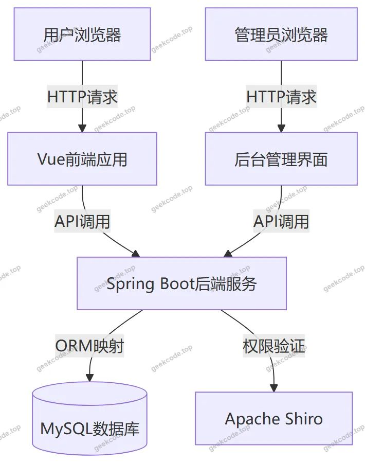</a>

<h3>2. 后端技术选型</h3>
<ul>
<li><strong>核心框架</strong>：使用 <code>spring-boot-starter-web</code> 构建 Web 应用，简化配置并快速启动服务。</li>
<li><strong>持久层</strong>：集成 <code>mybatis-spring-boot-starter</code> 和 <code>mybatis-plus</code>。MyBatis-Plus 提供了强大的 CRUD 自动生成能力，减少了重复 SQL 编写，提高了开发效率。</li>
<li><strong>数据库驱动</strong>：使用 <code>mysql-connector-java</code> 连接 MySQL 数据库。</li>
<li><strong>安全框架</strong>：引入 <code>shiro-spring</code> 实现身份认证与授权管理，确保后台管理接口的安全性及前台用户的数据隔离。</li>
<li><strong>工具类库</strong>：依赖 <code>commons-lang3</code> 处理字符串与通用对象操作，<code>validation-api</code> 用于参数校验，<code>protobuf-java</code> 可能用于特定数据传输格式优化。</li>
</ul>
<h3>3. 前端技术选型</h3>
<ul>
<li><strong>框架基础</strong>：基于 Vue.js 全家桶（Vue Router, Vuex/Pinia, Axios 等）构建单页应用（SPA）。</li>
<li><strong>UI 组件</strong>：适配 PC 端大屏显示需求，实现商城商品列表、商家详情、个人中心等页面的动态渲染。</li>
</ul>
<h3>4. 数据库设计要点</h3>

数据库主要围绕电商核心实体进行建模，包括用户表（yonghu）、商家表（shangjia）、商品表（shangchengshangpin）、商品种类表（shangpinzhonglei）、订单表（orders）、购物车表（cart）、评论表（discussshangchengshangpin）、公告表（news）及地址表（address）。各表之间通过外键或逻辑关联建立联系，如商品属于某个种类，订单包含多个商品明细等。

<h2>功能模块</h2>

根据源码 Controller 列表及路由配置，系统功能划分为前台用户端和后台管理端两大板块。

<h3>1. 前台用户端功能</h3>

前台面向普通消费者，主要提供浏览、购买及互动功能。

<ul>
<li><strong>首页展示</strong>：系统入口页面，聚合展示推荐内容。</li>
<li><strong>商城商品浏览</strong>：</li>
<li><strong>商品列表</strong>：分页展示所有上架商品，支持筛选。</li>
<li><strong>商品详情</strong>：查看单个商品的详细信息、价格、库存及图片。</li>
<li><strong>商品种类</strong>：按分类目录浏览商品。</li>
<li><strong>收藏列表</strong>：用户查看和管理已收藏的商品。</li>
<li><strong>商家中心</strong>：</li>
<li><strong>商家列表</strong>：展示入驻商家信息。</li>
<li><strong>商家详情</strong>：查看特定商家的店铺信息及所售商品。</li>
<li><strong>交易流程</strong>：</li>
<li><strong>购物车</strong>：添加、删除商品，计算总价，准备下单。</li>
<li><strong>订单管理</strong>：生成订单，查看订单状态（待付款、已完成等）。</li>
<li><strong>收货地址</strong>：管理用户的收货地址簿。</li>
<li><strong>互动与信息</strong>：</li>
<li><strong>商品评论</strong>：用户对已购买商品发表评价，支持查看其他用户评论。</li>
<li><strong>商城公告</strong>：查看平台发布的新闻或通知。</li>
<li><strong>在线客服</strong>：通过聊天接口（ChatController）实现用户与客服或商家的即时沟通。</li>
<li><strong>关于我们</strong>：展示平台简介信息。</li>
<li><strong>个人中心</strong>：用户登录后的专属区域，可修改个人信息、查看历史订单及收藏记录。</li>
</ul>
<h3>2. 后台管理端功能</h3>

后台面向系统管理员，用于维护平台数据和运营策略。

<ul>
<li><strong>系统基础设置</strong>：</li>
<li><strong>登录页</strong>：管理员身份认证入口。</li>
<li><strong>系统简介</strong>：编辑“关于我们”及系统介绍文本。</li>
<li><strong>配置管理</strong>：系统全局参数配置（ConfigController）。</li>
<li><strong>商品管理</strong>：</li>
<li><strong>商城商品</strong>：新增、编辑、删除、上下架商品，管理商品库存与价格。</li>
<li><strong>商品种类</strong>：维护商品分类树状结构。</li>
<li><strong>商城商品评论</strong>：审核、回复或删除用户提交的评论内容。</li>
<li><strong>用户与商家管理</strong>：</li>
<li><strong>用户管理</strong>：查看注册用户信息，禁用违规账号。</li>
<li><strong>商家管理</strong>：审核商家入驻申请，管理商家基本信息及资质。</li>
<li><strong>订单管理</strong>：</li>
<li><strong>订单列表</strong>：查看所有订单状态，处理发货、退款等业务逻辑。</li>
<li><strong>内容管理</strong>：</li>
<li><strong>商城公告</strong>：发布、编辑、删除平台公告新闻。</li>
<li><strong>文件管理</strong>：处理上传的图片、文档等资源（FileController）。</li>
</ul>
<h2>用户角色与权限</h2>

系统基于 Apache Shiro 框架实现细粒度的权限控制，主要涉及以下三类角色：

<h3>1. 普通用户 (Customer)</h3>
<ul>
<li><strong>权限范围</strong>：仅限前台访问。</li>
<li><strong>具体功能</strong>：</li>
<li>注册与登录。</li>
<li>浏览商品、商家、公告及系统简介。</li>
<li>将商品加入购物车、创建订单、支付订单。</li>
<li>管理个人收货地址。</li>
<li>收藏商品、取消收藏。</li>
<li>对已购买商品发表评论。</li>
<li>使用在线客服功能。</li>
<li>访问个人中心，查看自己的订单历史和收藏列表。</li>
<li><strong>限制</strong>：无法访问任何 <code>/admin</code> 路由或后台管理接口。</li>
</ul>
<h3>2. 商家 (Merchant)</h3>
<ul>
<li><strong>权限范围</strong>：根据系统设计，商家可能在后台拥有部分管理权限，或通过独立入口管理店铺。鉴于存在 <code>ShangjiaController</code> 且在前台有“商家列表”，推测商家作为特殊用户群体。</li>
<li><strong>具体功能</strong>：</li>
<li>入驻平台，完善店铺信息。</li>
<li>（若具备后台权限）管理自家店铺的商品上架、下架及库存更新。</li>
<li>（若具备后台权限）回复顾客对自己店铺商品的评论。</li>
<li>查看来自顾客的咨询消息。</li>
<li><strong>注意</strong>：具体是否拥有独立后台登录权限取决于 <code>Shiro</code> 配置中的角色划分，现有代码上下文未明确展示独立的商家后台路由，但 <code>ShangjiaController</code> 的存在暗示了商家数据的独立管理逻辑。</li>
</ul>
<h3>3. 系统管理员 (Admin)</h3>
<ul>
<li><strong>权限范围</strong>：全量后台访问权限。</li>
<li><strong>具体功能</strong>：</li>
<li>登录后台管理系统。</li>
<li><strong>商品域</strong>：管理所有商品、分类、评论。</li>
<li><strong>用户域</strong>：管理普通用户和商家账号，重置密码或冻结账户。</li>
<li><strong>订单域</strong>：监控全站订单状态，处理异常订单。</li>
<li><strong>内容域</strong>：发布和维护公告、系统简介、配置文件。</li>
<li><strong>资源域</strong>：管理服务器上的静态文件和上传资源。</li>
</ul>
<h2>项目特色与创新点</h2>
<ol>
<li><strong>完整的电商闭环模拟</strong>：项目不仅包含简单的商品展示，还涵盖了从“浏览-&gt;加购-&gt;下单-&gt;支付-&gt;评论-&gt;售后（订单管理）”的完整业务链路，具有较高的仿真度。</li>
<li><strong>多角色协同机制</strong>：引入了“商家”这一独立实体概念，区别于传统的纯自营模式，体现了平台型电商的特征，支持多商家入驻的管理逻辑。</li>
<li><strong>实时互动体验</strong>：集成了 <code>ChatController</code> 实现的在线客服/聊天功能，增强了买家与卖家或平台之间的即时沟通能力，提升了用户体验。</li>
<li><strong>健壮的安全架构</strong>：采用 Apache Shiro 而非简单的拦截器，提供了更成熟的认证、授权、加密和会话管理方案，保障了用户数据和后台操作的安全性。</li>
<li><strong>前后端分离的最佳实践</strong>：充分利用 Vue 的组件化优势与 Spring Boot 的微服务能力，使得系统易于维护、扩展和部署，符合现代企业级开发标准。</li>
</ol>
<h2>部署环境</h2>

为确保项目正常运行，需准备以下软件环境：

<h3>1. 硬件环境</h3>
<ul>
<li>CPU: Intel Core i5 及以上或同等性能处理器</li>
<li>内存: 8GB RAM 及以上</li>
<li>硬盘: 至少 50GB 可用空间</li>
</ul>
<h3>2. 软件环境</h3>
<ul>
<li><strong>操作系统</strong>: Windows 10/11, Linux (CentOS 7+), 或 macOS</li>
<li><strong>Java 运行环境</strong>: JDK 1.8 或更高版本（推荐 JDK 8 或 JDK 11，需兼容 Spring Boot 版本）</li>
<li><strong>数据库</strong>: MySQL 5.7 或 MySQL 8.0+</li>
<li><strong>构建工具</strong>: Maven 3.6+ (用于后端编译打包)</li>
<li><strong>前端运行环境</strong>: Node.js 14.x - 16.x (建议 LTS 版本)，npm 或 yarn</li>
<li><strong>Web 服务器</strong>: Nginx (用于生产环境前端静态资源托管及反向代理) 或内置 Tomcat (开发环境直接运行 Spring Boot Jar 包)</li>
</ul>
<h3>3. 开发工具 (可选)</h3>
<ul>
<li>IDE: IntelliJ IDEA 或 Eclipse (后端), VS Code (前端)</li>
<li>数据库管理工具: Navicat for MySQL 或 DBeaver</li>
</ul>
<h2>五、技术特性</h2>
<ul>
<li>前后端集成部署，前端资源打包至后端 static 目录</li>
<li>使用 MyBatis-Plus 简化数据访问层开发</li>
<li>集成 Shiro 权限框架实现角色权限控制</li>
</ul>
<h2>六、功能模块截图</h2>
<h3>前台用户端</h3>
<h4>前台-商城商品列表</h4>

<h4>前台-商家列表</h4>

<a href="https://geekcode.top/archives/%E5%9F%BA%E4%BA%8Evue%E5%85%A8%E5%AE%B6%E6%A1%B6%E7%9A%84pc%E7%AB%AF%E4%BB%BF%E6%B7%98%E5%AE%9D%E7%B3%BB%E7%BB%9Fkebgy%E5%9F%BA%E4%BA%8Evue%E5%85%A8%E5%AE%B6%E6%A1%B6%E7%9A%84pc%E7%AB%AF%E4%BB%BF%E6%B7%98%E5%AE%9D%E7%B3%BB%E7%BB%9Fkebgy-%E8%AE%BA%E6%96%87?utm_source=github" title="查看完整源码">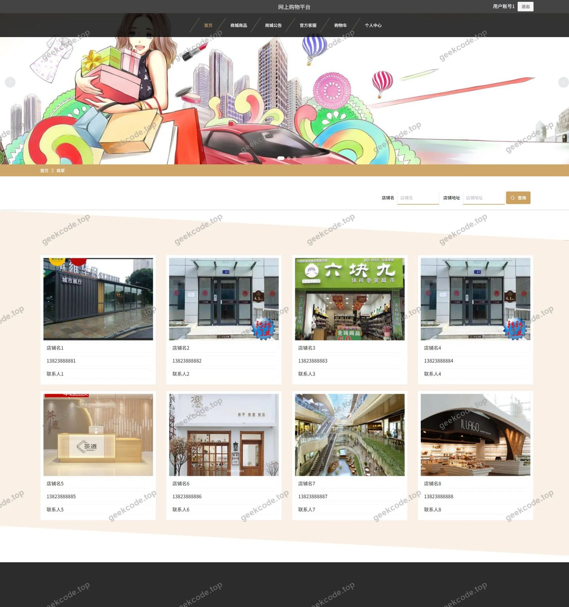</a>

<h4>前台-商品种类列表</h4>

<a href="https://geekcode.top/archives/%E5%9F%BA%E4%BA%8Evue%E5%85%A8%E5%AE%B6%E6%A1%B6%E7%9A%84pc%E7%AB%AF%E4%BB%BF%E6%B7%98%E5%AE%9D%E7%B3%BB%E7%BB%9Fkebgy%E5%9F%BA%E4%BA%8Evue%E5%85%A8%E5%AE%B6%E6%A1%B6%E7%9A%84pc%E7%AB%AF%E4%BB%BF%E6%B7%98%E5%AE%9D%E7%B3%BB%E7%BB%9Fkebgy-%E8%AE%BA%E6%96%87?utm_source=github" title="查看完整源码">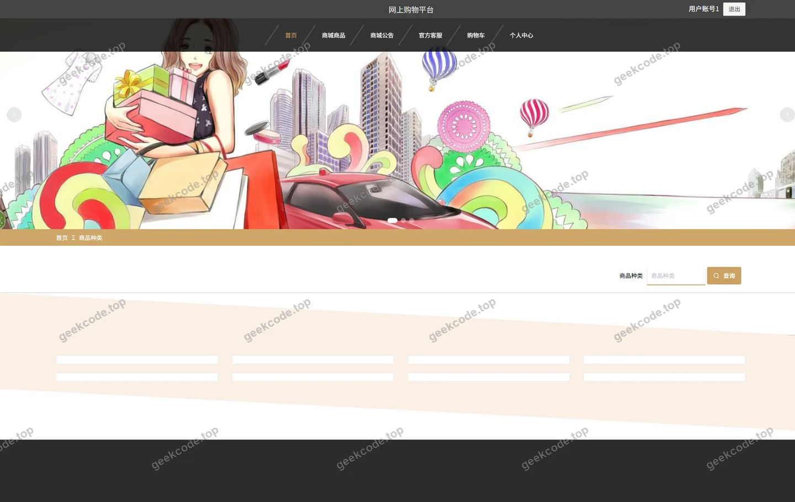</a>

<h4>前台-收藏列表</h4>

<a href="https://geekcode.top/archives/%E5%9F%BA%E4%BA%8Evue%E5%85%A8%E5%AE%B6%E6%A1%B6%E7%9A%84pc%E7%AB%AF%E4%BB%BF%E6%B7%98%E5%AE%9D%E7%B3%BB%E7%BB%9Fkebgy%E5%9F%BA%E4%BA%8Evue%E5%85%A8%E5%AE%B6%E6%A1%B6%E7%9A%84pc%E7%AB%AF%E4%BB%BF%E6%B7%98%E5%AE%9D%E7%B3%BB%E7%BB%9Fkebgy-%E8%AE%BA%E6%96%87?utm_source=github" title="查看完整源码">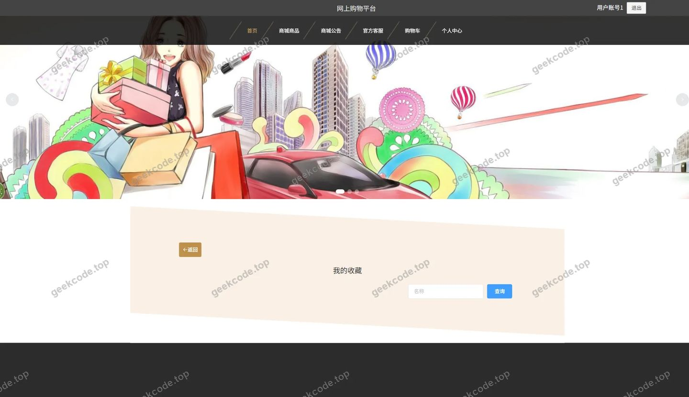</a>

<h4>前台-关于我们列表</h4>

<a href="https://geekcode.top/archives/%E5%9F%BA%E4%BA%8Evue%E5%85%A8%E5%AE%B6%E6%A1%B6%E7%9A%84pc%E7%AB%AF%E4%BB%BF%E6%B7%98%E5%AE%9D%E7%B3%BB%E7%BB%9Fkebgy%E5%9F%BA%E4%BA%8Evue%E5%85%A8%E5%AE%B6%E6%A1%B6%E7%9A%84pc%E7%AB%AF%E4%BB%BF%E6%B7%98%E5%AE%9D%E7%B3%BB%E7%BB%9Fkebgy-%E8%AE%BA%E6%96%87?utm_source=github" title="查看完整源码">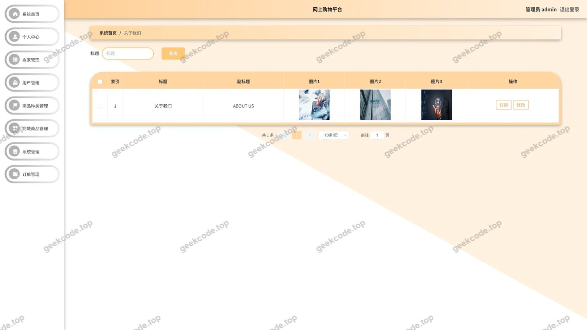</a>

<h4>前台-个人中心</h4>

<a href="https://geekcode.top/archives/%E5%9F%BA%E4%BA%8Evue%E5%85%A8%E5%AE%B6%E6%A1%B6%E7%9A%84pc%E7%AB%AF%E4%BB%BF%E6%B7%98%E5%AE%9D%E7%B3%BB%E7%BB%9Fkebgy%E5%9F%BA%E4%BA%8Evue%E5%85%A8%E5%AE%B6%E6%A1%B6%E7%9A%84pc%E7%AB%AF%E4%BB%BF%E6%B7%98%E5%AE%9D%E7%B3%BB%E7%BB%9Fkebgy-%E8%AE%BA%E6%96%87?utm_source=github" title="查看完整源码">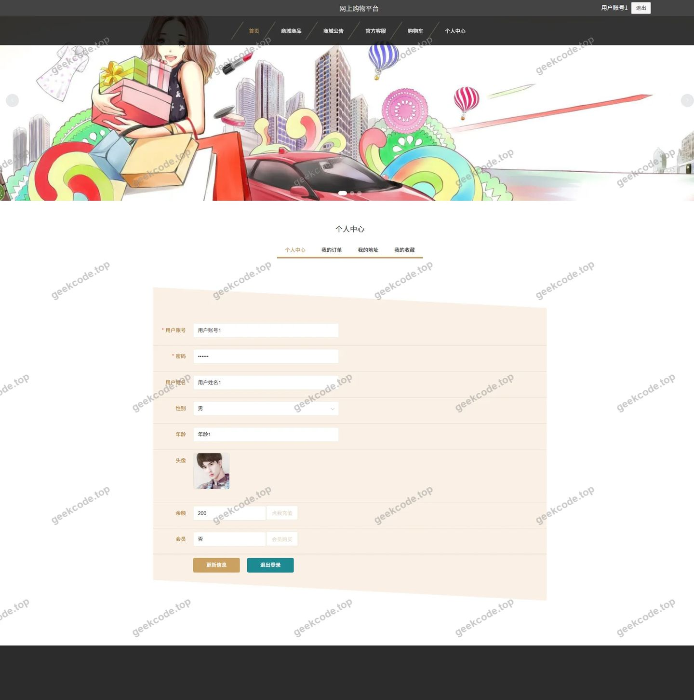</a>

<h4>前台-公告列表</h4>

<a href="https://geekcode.top/archives/%E5%9F%BA%E4%BA%8Evue%E5%85%A8%E5%AE%B6%E6%A1%B6%E7%9A%84pc%E7%AB%AF%E4%BB%BF%E6%B7%98%E5%AE%9D%E7%B3%BB%E7%BB%9Fkebgy%E5%9F%BA%E4%BA%8Evue%E5%85%A8%E5%AE%B6%E6%A1%B6%E7%9A%84pc%E7%AB%AF%E4%BB%BF%E6%B7%98%E5%AE%9D%E7%B3%BB%E7%BB%9Fkebgy-%E8%AE%BA%E6%96%87?utm_source=github" title="查看完整源码">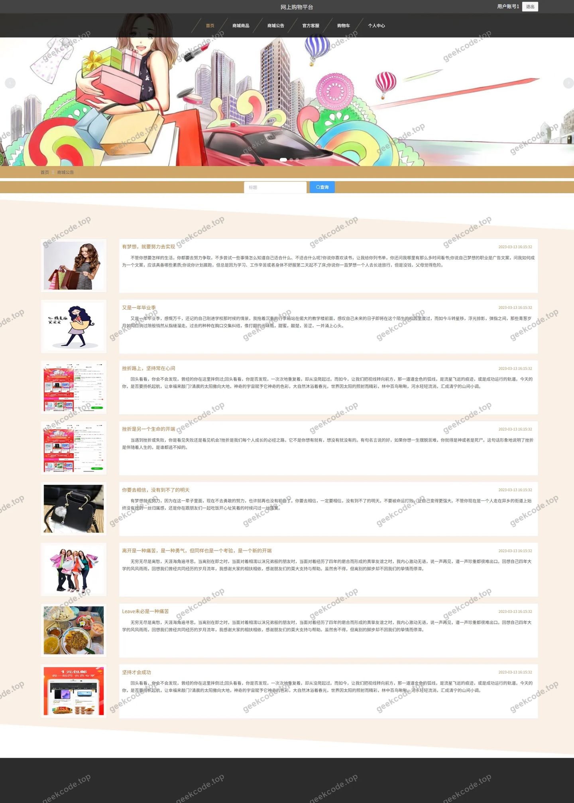</a>

<h3>后台管理端</h3>
<h4>后台-登录页</h4>

<a href="https://geekcode.top/archives/%E5%9F%BA%E4%BA%8Evue%E5%85%A8%E5%AE%B6%E6%A1%B6%E7%9A%84pc%E7%AB%AF%E4%BB%BF%E6%B7%98%E5%AE%9D%E7%B3%BB%E7%BB%9Fkebgy%E5%9F%BA%E4%BA%8Evue%E5%85%A8%E5%AE%B6%E6%A1%B6%E7%9A%84pc%E7%AB%AF%E4%BB%BF%E6%B7%98%E5%AE%9D%E7%B3%BB%E7%BB%9Fkebgy-%E8%AE%BA%E6%96%87?utm_source=github" title="查看完整源码">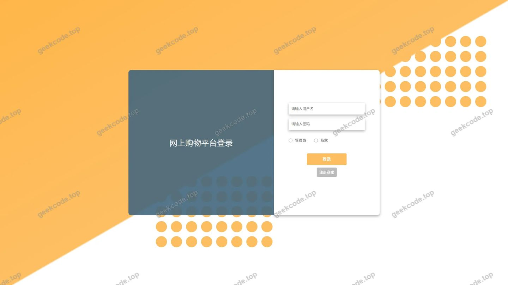</a>

<h4>后台-关于我们</h4>

<h4>后台-商城公告</h4>

<a href="https://geekcode.top/archives/%E5%9F%BA%E4%BA%8Evue%E5%85%A8%E5%AE%B6%E6%A1%B6%E7%9A%84pc%E7%AB%AF%E4%BB%BF%E6%B7%98%E5%AE%9D%E7%B3%BB%E7%BB%9Fkebgy%E5%9F%BA%E4%BA%8Evue%E5%85%A8%E5%AE%B6%E6%A1%B6%E7%9A%84pc%E7%AB%AF%E4%BB%BF%E6%B7%98%E5%AE%9D%E7%B3%BB%E7%BB%9Fkebgy-%E8%AE%BA%E6%96%87?utm_source=github" title="查看完整源码">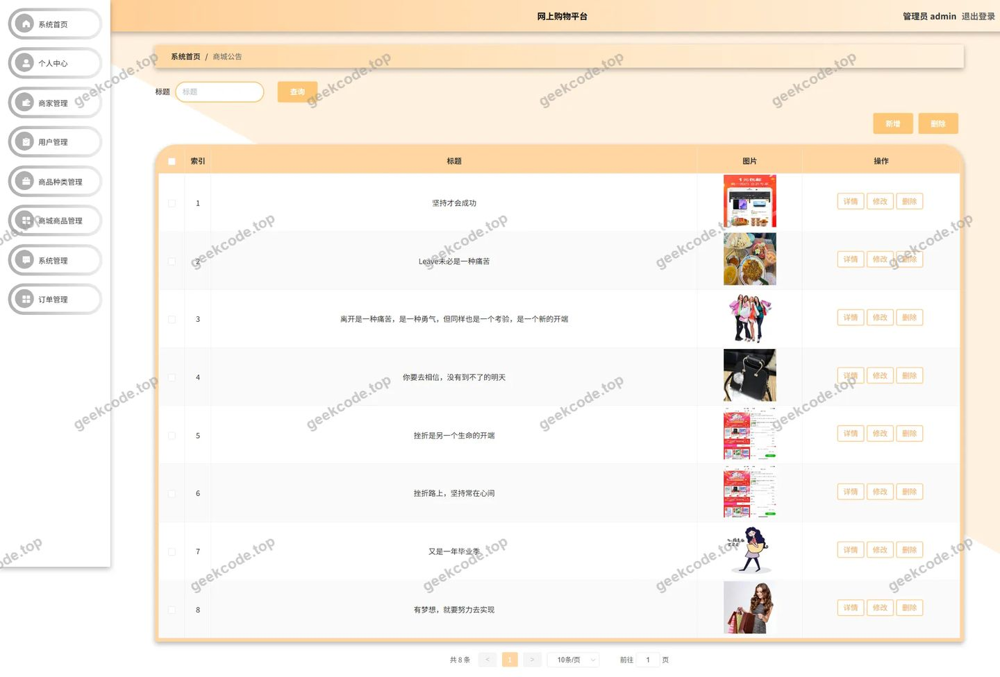</a>

<h4>后台-商城商品</h4>

<a href="https://geekcode.top/archives/%E5%9F%BA%E4%BA%8Evue%E5%85%A8%E5%AE%B6%E6%A1%B6%E7%9A%84pc%E7%AB%AF%E4%BB%BF%E6%B7%98%E5%AE%9D%E7%B3%BB%E7%BB%9Fkebgy%E5%9F%BA%E4%BA%8Evue%E5%85%A8%E5%AE%B6%E6%A1%B6%E7%9A%84pc%E7%AB%AF%E4%BB%BF%E6%B7%98%E5%AE%9D%E7%B3%BB%E7%BB%9Fkebgy-%E8%AE%BA%E6%96%87?utm_source=github" title="查看完整源码">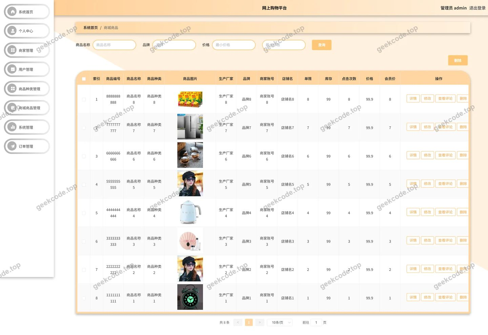</a>

<h4>后台-商城商品评论</h4>

<a href="https://geekcode.top/archives/%E5%9F%BA%E4%BA%8Evue%E5%85%A8%E5%AE%B6%E6%A1%B6%E7%9A%84pc%E7%AB%AF%E4%BB%BF%E6%B7%98%E5%AE%9D%E7%B3%BB%E7%BB%9Fkebgy%E5%9F%BA%E4%BA%8Evue%E5%85%A8%E5%AE%B6%E6%A1%B6%E7%9A%84pc%E7%AB%AF%E4%BB%BF%E6%B7%98%E5%AE%9D%E7%B3%BB%E7%BB%9Fkebgy-%E8%AE%BA%E6%96%87?utm_source=github" title="查看完整源码">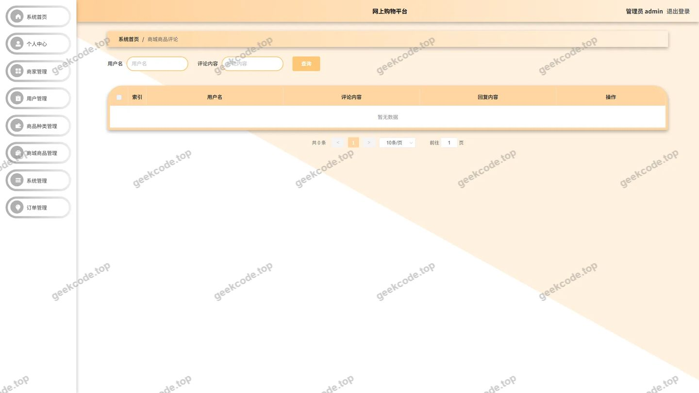</a>

<h4>后台首页</h4>

<a href="https://geekcode.top/archives/%E5%9F%BA%E4%BA%8Evue%E5%85%A8%E5%AE%B6%E6%A1%B6%E7%9A%84pc%E7%AB%AF%E4%BB%BF%E6%B7%98%E5%AE%9D%E7%B3%BB%E7%BB%9Fkebgy%E5%9F%BA%E4%BA%8Evue%E5%85%A8%E5%AE%B6%E6%A1%B6%E7%9A%84pc%E7%AB%AF%E4%BB%BF%E6%B7%98%E5%AE%9D%E7%B3%BB%E7%BB%9Fkebgy-%E8%AE%BA%E6%96%87?utm_source=github" title="查看完整源码">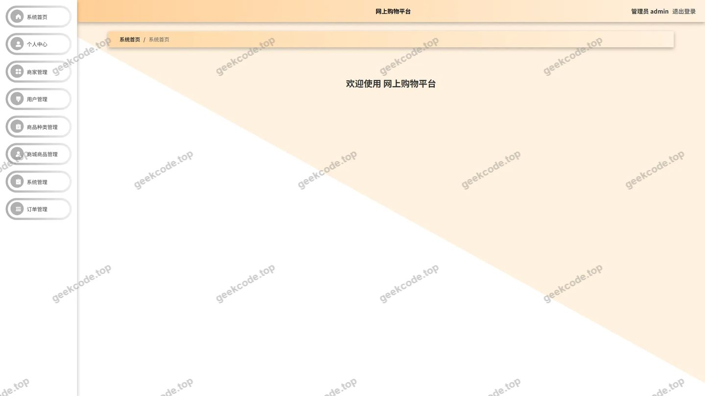</a>

<h4>后台-用户</h4>

<a href="https://geekcode.top/archives/%E5%9F%BA%E4%BA%8Evue%E5%85%A8%E5%AE%B6%E6%A1%B6%E7%9A%84pc%E7%AB%AF%E4%BB%BF%E6%B7%98%E5%AE%9D%E7%B3%BB%E7%BB%9Fkebgy%E5%9F%BA%E4%BA%8Evue%E5%85%A8%E5%AE%B6%E6%A1%B6%E7%9A%84pc%E7%AB%AF%E4%BB%BF%E6%B7%98%E5%AE%9D%E7%B3%BB%E7%BB%9Fkebgy-%E8%AE%BA%E6%96%87?utm_source=github" title="查看完整源码">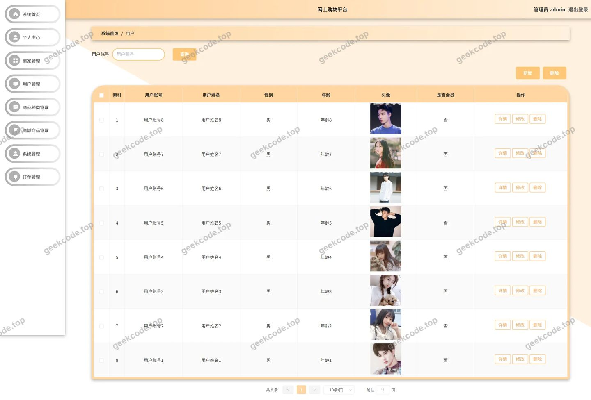</a>

<h4>后台-系统简介</h4>

<a href="https://geekcode.top/archives/%E5%9F%BA%E4%BA%8Evue%E5%85%A8%E5%AE%B6%E6%A1%B6%E7%9A%84pc%E7%AB%AF%E4%BB%BF%E6%B7%98%E5%AE%9D%E7%B3%BB%E7%BB%9Fkebgy%E5%9F%BA%E4%BA%8Evue%E5%85%A8%E5%AE%B6%E6%A1%B6%E7%9A%84pc%E7%AB%AF%E4%BB%BF%E6%B7%98%E5%AE%9D%E7%B3%BB%E7%BB%9Fkebgy-%E8%AE%BA%E6%96%87?utm_source=github" title="查看完整源码">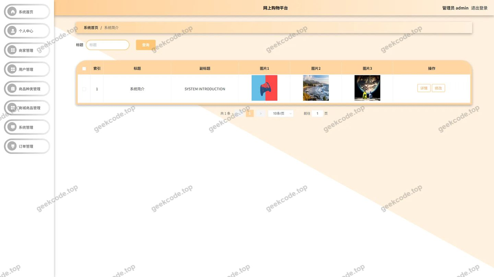</a>

---

## 获取完整源码

| 项目 | 说明 |
| --- | --- |
| 项目名 | 基于vue全家桶的pc端仿淘宝系统kebgy基于vue全家桶的pc端仿淘宝系统kebgy--论文 |
| 运行截图 | 本文 16 张（站点带水印原图，仓库 `images/` 目录） |
| 完整源码 | [https://geekcode.top/archives/%E5%9F%BA%E4%BA%8Evue%E5%85%A8%E5%AE%B6%E6%A1%B6%E7%9A%84pc%E7%AB%AF%E4%BB%BF%E6%B7%98%E5%AE%9D%E7%B3%BB%E7%BB%9Fkebgy%E5%9F%BA%E4%BA%8Evue%E5%85%A8%E5%AE%B6%E6%A1%B6%E7%9A%84pc%E7%AB%AF%E4%BB%BF%E6%B7%98%E5%AE%9D%E7%B3%BB%E7%BB%9Fkebgy-%E8%AE%BA%E6%96%87?utm_source=github](https://geekcode.top/archives/%E5%9F%BA%E4%BA%8Evue%E5%85%A8%E5%AE%B6%E6%A1%B6%E7%9A%84pc%E7%AB%AF%E4%BB%BF%E6%B7%98%E5%AE%9D%E7%B3%BB%E7%BB%9Fkebgy%E5%9F%BA%E4%BA%8Evue%E5%85%A8%E5%AE%B6%E6%A1%B6%E7%9A%84pc%E7%AB%AF%E4%BB%BF%E6%B7%98%E5%AE%9D%E7%B3%BB%E7%BB%9Fkebgy-%E8%AE%BA%E6%96%87?utm_source=github) |
| 咨询微信 | **ir9372**（备注：jingpin-yuanma） |
| 更多项目 | [极客代码 geekcode.top](https://geekcode.top/?utm_source=github) |

> 需要源码、部署、改配置、跑不起来等问题，加微信 ir9372 沟通，说明项目名即可。
